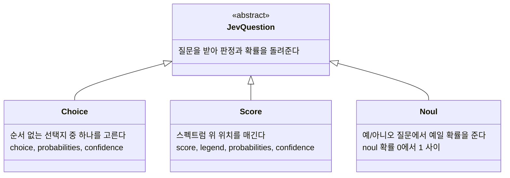
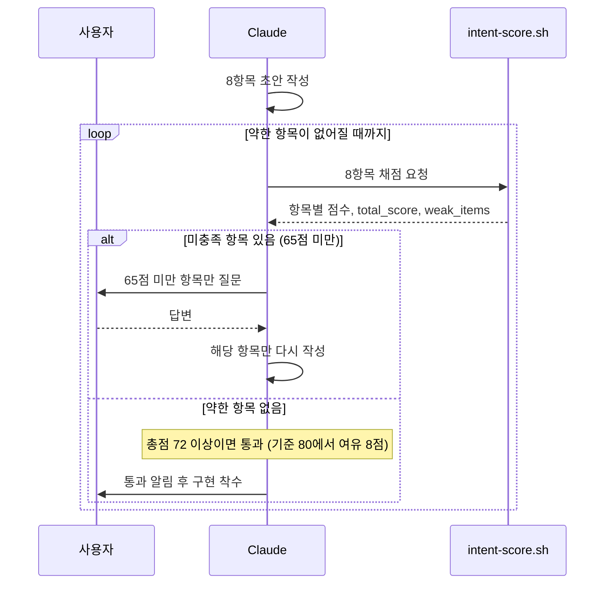
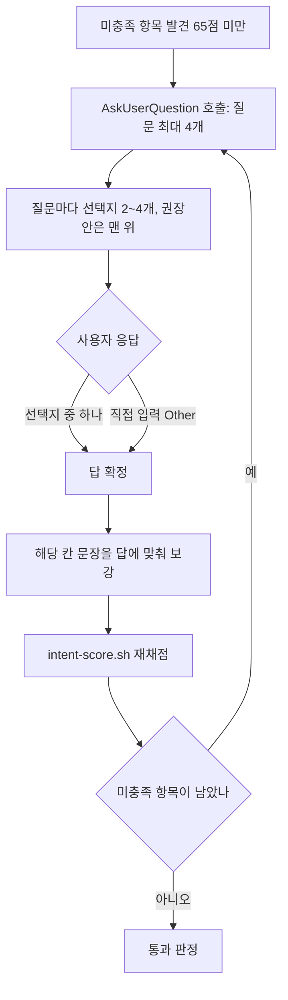
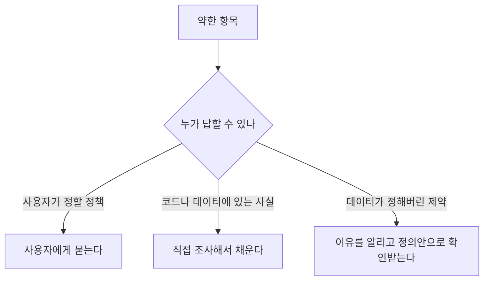

---
author:
  - padawanr0k
title: Jev로 프롬프트의 밀도 높이기
date: 2026-10-09
tags:
  - ai
  - claude-code
layout: post
---
프롬프트를 잘 작성한다는건 뭘까? 내가 하려는 작업의 메타인지와 그게 잘 표현된 프롬프트가 좋은 프롬프트가 아닐까 싶다.
그런 프롬프트를 작성할 때 생체토큰을 써야하기 때문에... jev를 활용해 스킬을 하나 만들어보았다.

## Jev는 결정에 특화된 모델이다.

일반적인 LLM은 질문을 받으면 문장을 생성한다. Jev는 문장을 쓰지 않고 판정과 확률을 돌려준다. 코드가 그 결과를 받아서 바로 분기할 수 있게 설계된 모델이라고 보면 된다.

질문 유형은 세 가지다. Choice는 순서가 없는 선택지 중 하나를 고르는 질문이고, Score는 단계를 설명해 둔 스펙트럼 위에서 어디쯤인지 알려준다, Noul은 예/아니오 질문에 '예'일 확률(0~1)을 준다.

세 유형의 관계를 클래스 다이어그램으로 그리면 이렇다.

confidence는 확률이 한쪽에 얼마나 몰렸는지를 나타내는 값이라서, 낮다고 판정이 틀렸다는 뜻은 아니다. 이 구분을 놓치면 숫자를 잘못 읽게 된다.

 이 중에 Score를 활용해보았다

목표는 다음과 같이 간단히 질문해도 명확한 프롬프트가 최종적으로 전달되는것이다.
> /intent-score @packages/lecture/ 강의실 플레이어의 에러와 기존 유저 재학습,재구매,학습시간과의 인과관계를 bigquery, mixpanel, datadog 도구로 찾아서 정리

단순하게 저렇게 전달하면 에이전트가 혼자 정해야 할 게 많다.
분석 기간은 얼마로?
'재학습'과 '재구매'를 어떤 기준으로?
인과관계를 상관 수준에서 볼지 원인까지 볼지?

빈칸을 내가 채우지 않으면 에이전트가 채운다. 

## 프롬프트의 여백 줄이기 

스킬에는 8가지의 항목을 기준으로 밀도를 높인다.

- Goal 목표 
- Current 현재 상태
- Desired 원하는 결과 
- Scope 범위 
- Constraints 제약 
- Non-goals 하지 않을 것 
- Success 완료 기준 
- Assumptions 가정

### 루프

Claude가 여덟 칸 초안을 쓰면 스킬이 항목별 점수와 65점 미만 목록을 JSON으로 돌려준다. Claude는 그 항목만 사용자에게 묻거나 직접 조사하고, 답을 반영해 해당 만 다시 쓴 뒤 재채점한다.

루프를 도는 주체는 스크립트가 아니라 Claude다. 스크립트는 호출될 때마다 채점 결과만 찍고 끝나는 순수 함수다. 

고른 답은 질문 창에서 끝나지 않는다. 해당 칸의 문장에 반영된 뒤에야 재채점이 돌아간다. 이 단계가 프롬프트를 실제로 보강하는 순간이다.

통과 기준 80점은 점수를 최대로 올리기 위한 목표가 아니다. 더 채울 칸이 남았는지를 가르는 경계다. 처음엔 90점을 생각했는데, 파일 경로와 수치, 금지사항까지 구체적으로 쓴 초안도 반복 채점에서 79.7~82.1점에 머물렀다. 같은 항목을 세 번 채점했을 때도 90.0, 91.5, 92.5로 2.5점 정도 흔들렸다. 측정이 가능한 구간으로 기준을 내려서 80점이 됐다.

기준을 80으로 두면 한 가지 교착이 생긴다. 미충족 항목이 하나도 없는데 총점이 80에 못 미치면, 물을 것도 없고 통과도 못 한다. 그래서 미충족 항목이 없을 때에 한해 8점 여유를 줘서 72점 이상이면 통과시켰다. 이 8점은 재채점 흔들림의 약 3배다. 여유가 없으면 여덟 칸이 전부 66~78점에 몰린 초안도 그냥 통과해서, 80점이라는 기준이 의미를 잃는다.

## 빈칸은 채우는 곳이 다르다

질문만으로 밀도를 올리면 안 된다. 빈칸마다 답이 나오는 곳이 다르기 때문이다.

기간, 지표 정의, 판정 기준, 결과물 형태처럼 사용자가 정할 정책은 묻는다. 에러 로깅 방식이나 유저 ID 연결 여부, 보관 기간처럼 코드나 데이터에 이미 있는 사실은 직접 조사한다. 데이터가 정해 버린 제약은 고를 선택지가 없으니, 이유를 알리고 정의안에 담아 확인받는다.

> 실제 항목을 채우는 예시

**Q1. 분석 기간은 어떻게 잡을까요?**

- ✔ **1. 최근 90일 (Recommended)**
- 2. 최근 30일
- 3. 최근 180일

**Q2. '재학습'·'재구매'·'기존 유저'를 무엇으로 정의할까요?**

- ✔ **1. 제가 제안하고 확인받기 (Recommended)**
- 2. 팀 내 기존 정의 사용

**Q3. '인과관계'를 어느 수준까지 원하시나요?**

- ✔ **1. 상관 + 교란 통제 (Recommended)**
- 2. 단순 상관 비교
- 3. 준실험(자연실험) 설계

**Q4. 결과물은 어떤 형태로 받으시겠어요?**

- ✔ **1. 공유용 문서/아티팩트 (Recommended)**
- 2. 터미널 요약만
- 3. Confluence 페이지

**Q5. '영향을 준다'고 결론 내릴 기준을 무엇으로 둘까요?**

- 1. 통계적 유의성 + 실무 차이 (Recommended)
- 2. 통계적 유의성만
- ✔ **3. 기준 없이 수치만 제시**

**Q6. 지표 정의안입니다. 이대로 진행할까요? (기간은 30일로 축소)**

- ✔ **1. 이대로 진행 (Recommended)**
- 2. 재구매 창을 30일로 고정

---

또 어디에 써볼까..
